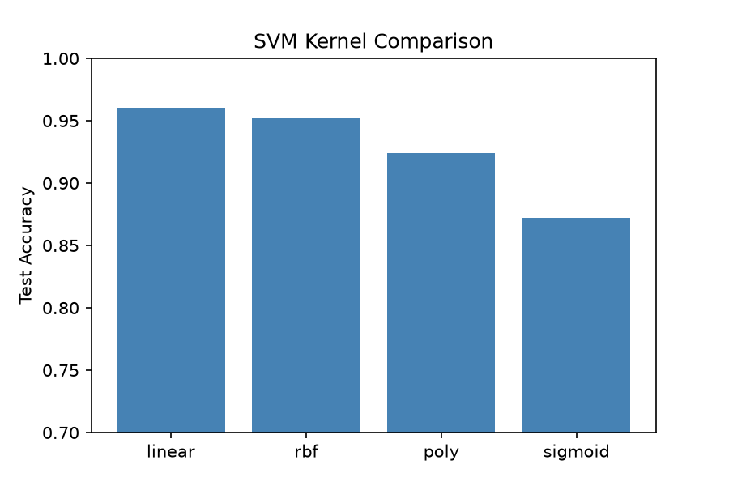
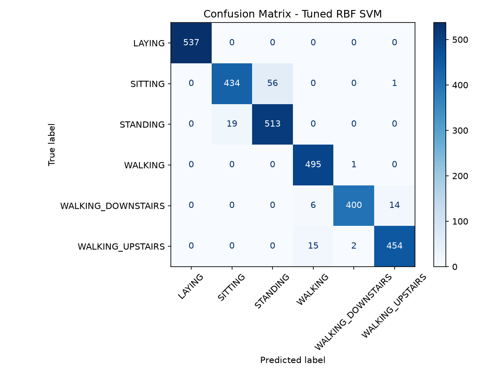

# 🏃 Human Activity Recognition using SVM with Kernels

Classifies 6 human activities (Walking, Upstairs, Downstairs, Sitting, Standing, Laying) from smartphone accelerometer and gyroscope data using Support Vector Machines.

## Results
| Kernel | Test Accuracy |
|--------|---------------|
| Tuned RBF (C=1000, γ=3e-5) | **96.1%** |

- Compared linear, RBF, polynomial and sigmoid kernels
- Tuned C and gamma with GridSearchCV (3-fold CV), then extended the grid when the best values landed on its edge
- Main error source: Sitting vs Standing. A waist-mounted sensor sees a similar upright torso in both.

## Tech
Python, scikit-learn, pandas, matplotlib, seaborn, Streamlit

## Run it
1. Download the dataset from [Kaggle](https://www.kaggle.com/datasets/uciml/human-activity-recognition-with-smartphones) and put `train.csv` and `test.csv` in `data/`
2. `pip install -r requirements.txt`
3. Notebook: `jupyter notebook har_svm.ipynb`
4. Demo app: `streamlit run app.py`

## Dataset
UCI HAR Dataset: 30 volunteers, 561 features per 2.56s window.
